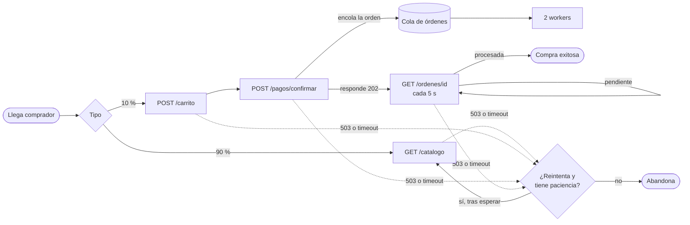
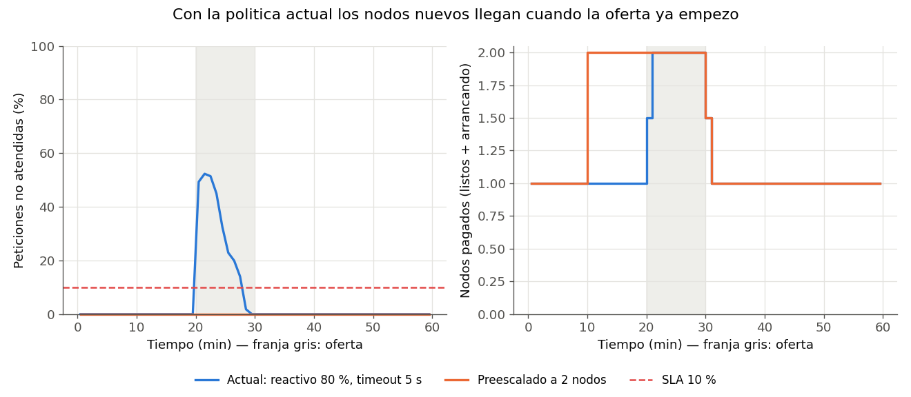
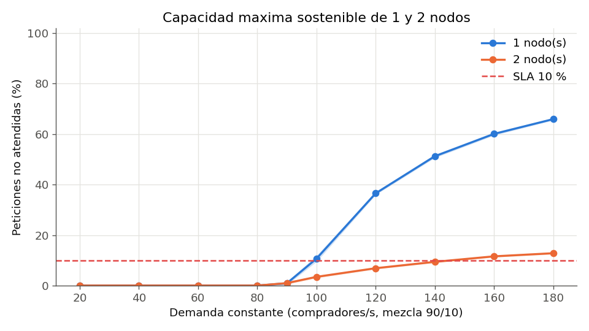
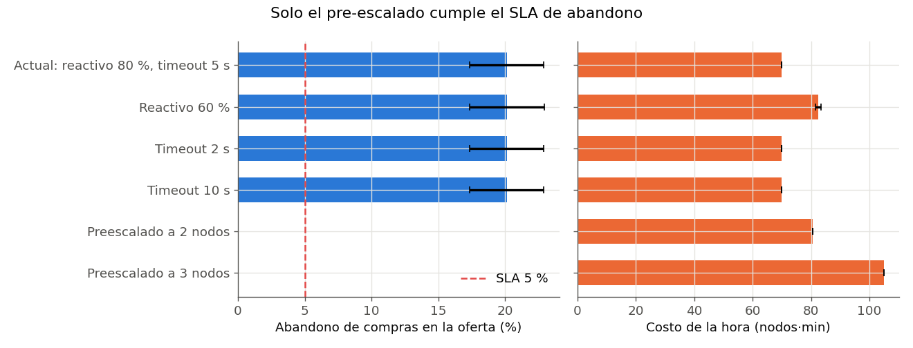

# Informe Final: Gemelo digital de una plataforma de comercio electrónico bajo campañas de descuento

- **Curso:** Modelos y Simulación (2026-2), I.U. Pascual Bravo
- **Grupo:** Grupo 1
- **Repositorio:** <https://github.com/Analopez0604/pa-modelos-simulacion-ecommerce>
- **Comando de despliegue API:** `docker compose up --build -d`
- **Comando de ejecución SimPy:** `python simulacion/main.py` (genera [`resultados_simulacion.md`](resultados_simulacion.md) y las figuras)
- **Panel visual para la demostración en vivo:** `streamlit run panel.py`

| Integrante | Correo Institucional | Rol Ejecutado | Commits Principales (Módulos) |
| :--- | :--- | :--- | :--- |
| Ana Isabel López Durán | <ana.lopez710@pascualbravo.edu.co> | Modelo de simulación e integración del repositorio | `simulacion/` (parámetros, recolector, modelo, políticas, gráficas, experimentos), `panel.py`, configuración del repositorio e integración de los PR del equipo |
| Gerónimo Álvarez Saldarriaga | <geronimo.alvarez454@pascualbravo.edu.co> | Sistema real: API, contenedores y mediciones | `sistema_real/app/` (config, modelo de datos, endpoints, telemetría, worker), `docker-compose.yml`, `Dockerfile`, corridas y datos de `datos/` |
| Brandon Steven Vidal Jaramillo | <brandon.vidal578@pascualbravo.edu.co> | Generador de carga, calibración y contraste analítico | `sistema_real/gateway.py`, `analisis/calibrar.py`, `analisis/estilo.py`, `analisis/contraste_mmc.py`, figuras de calibración y de contraste |

---

## 1. Resumen Ejecutivo

Una tienda en línea lanza ofertas relámpago. Durante 10 minutos, la navegación se multiplica por 20 y las compras por 6. Montamos un sistema real mínimo (API + PostgreSQL + workers de órdenes en Docker), lo medimos bajo carga y con esas mediciones calibramos un modelo de eventos discretos en SimPy. Con 30 réplicas por configuración comparamos la política actual (autoescalado reactivo al 80 % de CPU, timeout de 5 s) contra bajar el umbral al 60 %, cambiar el timeout a 2 o 10 s y pre-escalar antes de la oferta. Con la política actual, durante la oferta no se atiende el 33 % de las peticiones y abandona el 20 % de los que iban a comprar. La causa es que un nodo nuevo tarda de 2 a 8 minutos en arrancar. Bajar el umbral o cambiar el timeout no mejora nada. Recomendamos pre-escalar a 2 nodos 10 minutos antes de la oferta: el abandono baja a 0 % y la CPU máxima queda en 73 %. A cambio, la hora cuesta 15 % más (80,5 vs. 70,0 nodos·min). Pagamos unos 10 minutos más de un nodo para no perder a uno de cada cinco compradores.

## 2. Contexto del Sistema y Subsanación de la Entrega 1

### 2.1 Dinámica del Sistema (Qué fluye, qué espera, qué se satura)

- **Entidades que fluyen:** *compradores* de dos tipos (90 % solo miran el catálogo, 10 %
  compran), *peticiones* HTTP (cada reintento cuenta como una petición nueva y le suma carga
  al sistema [1]) y *órdenes* (se
  crean al confirmar el pago y las procesa un worker).
- **Recursos y colas** (los mismos valores están en `docker-compose.yml` y `simulacion/parametros.py`):

  | Recurso | Capacidad | Disciplina | Si se llena |
  | :--- | :--- | :--- | :--- |
  | Punto de acceso de un nodo | 100 peticiones a la vez | — | responde 503 |
  | CPU de un nodo | 1 servidor (0,5 CPU del contenedor) | FIFO | se espera en cola |
  | Workers de órdenes | 2 | FIFO | crece la cola de órdenes |
  | Cola de órdenes | tope 500 | FIFO | el pago responde 503 |

  No modelamos el pool de 10 conexiones a la base de datos. En todas las pruebas, esperar una
  conexión tomó de 0,1 a 0,2 ms, así que nunca fue un límite.
- **Límite físico (C6):** la CPU del nodo. Cada petición gasta en promedio 7,4 ms de nodo, así
  que un nodo no puede atender más de 1 / 7,4 ms ≈ **135 peticiones/s**.
- **Comportamiento del comprador (C7):** cada comprador tiene una paciencia Weibull (media
  20 s) y decide una sola vez si es de los que reintentan (60 %). Si una petición le falla,
  reintenta hasta 3 veces y entre intentos espera 1, 2 y 4 s (±50 %). Abandona si no
  reintenta, si se le acaban los reintentos o si se le acaba la paciencia, incluso mientras
  espera su orden.

Este es el flujo del modelo con la **ruta de escritura corregida**, que fue una observación de
la Entrega 1:

Cada petición (lectura, carrito, pago o consulta) pasa por un nodo: punto de acceso → cola
de CPU → servicio Lognormal → respuesta. Un reintento repite la misma petición que falló.

### 2.2 Tabla de Subsanación de la Entrega Parcial 1

| Observación / Error en Entrega 1 | Corrección Implementada en la Entrega Final | Archivo / Línea en el Repositorio |
| :--- | :--- | :--- |
| Solo existía el README | API en Docker con base de datos y telemetría, modelo SimPy, contraste M/M/c y experimentos | `sistema_real/`, `simulacion/`, `analisis/` |
| Ruta de escritura (carrito y pagos) incompleta | Carrito → pago (encola la orden, responde 202) → consulta de la orden cada 5 s | `simulacion/modelo.py` (`comprador_compra`), diagrama 2.1 |
| Lognormales sin parámetros completos | μ y σ ajustados con los datos medidos para cada tipo de petición (tabla 3.2) | `analisis/calibrar.py` |
| Tiempos de servicio supuestos (40/60/250 ms) | Reemplazados por lo medido en el sistema real | `simulacion/parametros_calibrados.json` |
| Paciencia Exponencial ("sin memoria") | Weibull k = 2: la probabilidad de irse crece con la espera, que es lo que significa impaciencia | `simulacion/parametros.py` |
| "Máximo 3 reintentos" con espera 1-2-4 s, pero el código nunca llegaba a 4 s | 3 reintentos = 4 intentos en total | `simulacion/modelo.py` (`con_reintentos`) |
| 1 worker de órdenes: con 6 compras/s, ρ = 6 × 0,275 = 1,65 (cola sin fin) | 2 workers: ρ = 0,83 | `docker-compose.yml`, `parametros.py` |
| Sección 7.6 decía "cinco supuestos" y listaba seis; Little "confirmaba" el estado estable | Little se comprueba con mediciones independientes en SimPy (sección 4.1) | `analisis/contraste_mmc.py` |

## 3. Arquitectura del Prototipo, Telemetría y Parámetros Calibrados

### 3.1 Sistema real y telemetría

### 3.2 Parámetros y Distribuciones de Entrada del Modelo SimPy

## 4. Diseño Experimental y Contraste Analítico (M/M/c vs. SimPy)

### 4.1 Tabla de Validación Analítica (Régimen Estacionario Exponencial)

## 5. Resultados de la Simulación y Evaluación de Políticas de Decisión

### 5.1 Comparación Cuantitativa de Escenarios

Los KPIs son de los 10 min de la oferta, y el costo es el de la hora completa. Media ± IC 95 %,
30 réplicas.

| KPI (con unidad) | Umbral SLA | Política Actual (reactivo 80 %, timeout 5 s) | Alt. 1: Reactivo 60 % | Alt. 2: Timeout 10 s | Alt. 3: Pre-escalado a 2 nodos | ¿Cumple SLA? |
| :--- | :---: | :---: | :---: | :---: | :---: | :---: |
| p95 de latencia (s) | < 2,0 | 0,74 ± 0,00 | 0,74 ± 0,00 | 0,74 ± 0,00 | **0,03 ± 0,00** | Todas |
| p99 de latencia (s) | — | 0,78 ± 0,00 | 0,78 ± 0,00 | 0,78 ± 0,00 | **0,04 ± 0,00** | — |
| Peticiones no atendidas (%) | < 10 | 33,0 ± 3,5 | 33,0 ± 3,5 | 33,0 ± 3,5 | **0,0** | Solo Alt. 3 |
| Abandono de compras (%) | < 5 | 20,1 ± 2,8 | 20,1 ± 2,8 | 20,1 ± 2,8 | **0,0** | Solo Alt. 3 |
| Amplificación (peticiones/operación) | < 1,5 | 1,37 ± 0,04 | 1,37 ± 0,04 | 1,37 ± 0,04 | **1,06** | Todas |
| CPU máxima (%) | < 85 | 100 | 100 | 100 | **73** | Solo Alt. 3 |
| Costo (nodos·min) | comparativo | 70,0 ± 0,0 | 82,6 ± 1,0 | 70,0 ± 0,0 | 80,5 ± 0,0 | — |

El timeout de 2 s y el pre-escalado a 3 nodos están en
[`resultados_simulacion.md`](resultados_simulacion.md). Ojo con la primera fila: la política
actual "cumple" el p95 aunque pierde un tercio de las peticiones. Eso pasa porque el p95 solo
mide las peticiones que sí se atendieron. Por eso la latencia y las no atendidas hay que
leerlas juntas.

### 5.2 Análisis de las Preguntas de Decisión

- **P1. Umbral de autoescalado.** Bajar de 80 % a 60 % **no cambia nada durante la oferta**.
  Cuando empieza la oferta, la CPU salta al 100 % y con cualquier umbral se pide un nodo más.
  El daño pasa mientras ese nodo arranca (2 a 8 min), y el umbral no lo hace arrancar más
  rápido. Con 60 %, cuando llega el segundo nodo la CPU queda cerca del 73 %, que sigue por
  encima del umbral. Entonces se pide un tercero que llega cuando ya no hace falta:
  **+12,6 nodos·min (+18 %)** sin ningún beneficio.
- **P2. Timeout del cliente.** Con 2, 5 o 10 s el resultado es el mismo. Un nodo admite máximo
  100 peticiones y cada una tarda unos 7,4 ms, así que nadie espera más de ≈ 100 × 7,4 ms ≈
  0,74 s (justo el p95 medido). El nodo rechaza antes de que el timeout alcance a actuar.
- **P3. Anticipación de capacidad.** Si pedimos 2 nodos 10 min antes de la oferta, el abandono
  queda en **0 %** y la CPU máxima en 73 %, por 80,5 nodos·min (**+10,5, o sea +15 %**). La
  razón es que la política actual paga el segundo nodo unos 10 min y el pre-escalado unos
  20 min. Con 3 nodos también se cumple, pero cuesta 105 nodos·min (+50 %) y no mejora nada.
- **P4. Capacidad máxima sostenible.** Con demanda constante (90/10), **un nodo cumple el
  SLA hasta 90 compradores/s** (CPU 96 %). A 100 compradores/s ya deja sin atender el 10,6 %,
  igual que el nodo real en la prueba escalonada (10,6 %). **Dos nodos aguantan hasta 140
  compradores/s**. De ahí para arriba el límite ya no es la CPU sino los 2 workers de órdenes
  (unas 7 órdenes/s): la cola de órdenes se llena y los pagos reciben 503.

## 6. Recomendación de Ingeniería y Declaración de Uso de IA

### 6.1 Recomendación Técnica Final

**Pre-escalar a 2 nodos 10 minutos antes de cada oferta** y dejar activo el autoescalado reactivo al 80 % como respaldo (es el mismo que vuelve a dejar 1 nodo cuando la oferta termina). Es la opción más barata que cumple el SLA. Cuesta 15 % más que la política actual (80,5 vs. 70,0 nodos·min), pero baja el abandono de compras de 20 % a 0 %. En pocas palabras, pagamos unos 10 minutos más de un nodo por campaña para no perder a uno de cada cinco compradores. No vale la pena bajar el umbral (cuesta 18 % más, incluso más que pre-escalar, y no ayuda) ni cambiar el timeout (no tiene efecto). Si una campaña espera más de 140
compradores/s, hay que pre-escalar más nodos y también agregar workers de órdenes.

### 6.2 Declaración de Uso de Inteligencia Artificial

Usamos IA como lo permite la guía del curso, sobre todo para escribir y revisar código y documentación. El problema, las preguntas de decisión, las métricas, el SLA y los supuestos del modelo vienen de nuestra Entrega 1. Los números de este informe no los escribió la IA: salen de correr el sistema real y la simulación (`docs/resultados_simulacion.md` y `docs/contraste_mmc.md`).

| Herramienta de IA | Secciones / Módulos donde se utilizó | Qué verificó, corrigió y validó el equipo |
| :--- | :--- | :--- |
| Claude Code (Anthropic), asistente de programación | Código de la API, el worker y el generador de carga (`sistema_real/`, `docker-compose.yml`); modelo SimPy, políticas y métricas (`simulacion/`); calibración y contraste (`analisis/`); figuras; comentarios del código | El modelo en modo M/M/c da lo mismo que las fórmulas que calculamos a mano en la Entrega 1 (error ≤ 2,4 % con ρ ≥ 0,7). Gerónimo levantó el sistema en Docker y corrió las pruebas de carga de `datos/`; explica la telemetría y el límite físico C6. Brandon corrió `calibrar.py` y `contraste_mmc.py` y verificó el contraste contra los cálculos manuales. Ana corrió los experimentos de `simulacion/main.py` y revisó el modelo archivo por archivo; explica las decisiones de diseño |
| Claude Code (Anthropic) | Panel visual (`panel.py`), un extra para la demostración que no pide la guía | Lo hizo la IA casi completo. Sabemos explicar qué muestra cada página y de dónde sale cada número. Ningún resultado del informe sale del panel: este solo lee `docs/resultados_simulacion.json` y corre el mismo modelo de `simulacion/modelo.py` |
| Claude Code (Anthropic) | Redacción del README y de este informe | Revisamos que cada número del informe coincida con los archivos generados (`docs/resultados_simulacion.md`, `docs/contraste_mmc.md`, `datos/`). La interpretación de los resultados y la recomendación final las escribimos nosotros a partir de esos datos |
| Claude Code (Anthropic) | Ayuda con la redacción de los mensajes de commit y descripción de los PR | Cada integrante subió sus archivos desde su cuenta y en su rama. Por eso las descripciones de los PR dicen que se generaron con Claude Code. |
| Claude / ChatGPT (Entrega 1) | Conceptos, redacción y revisión de la Entrega 1 | Ver la declaración de la Entrega 1 |

### 6.3 Referencias

